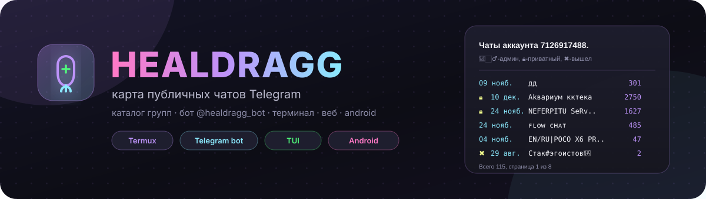
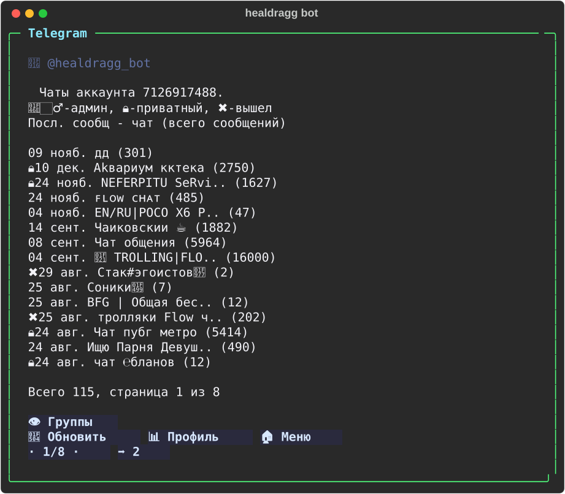
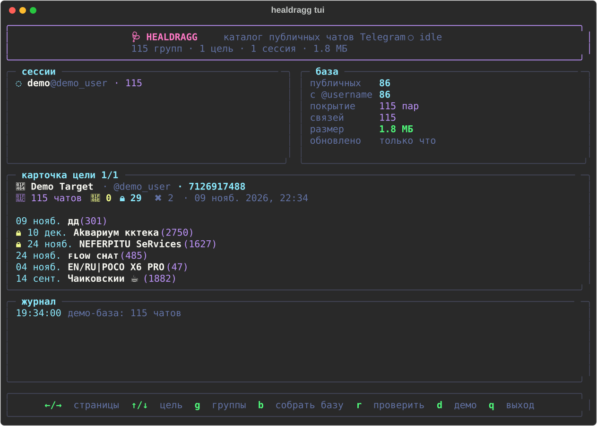
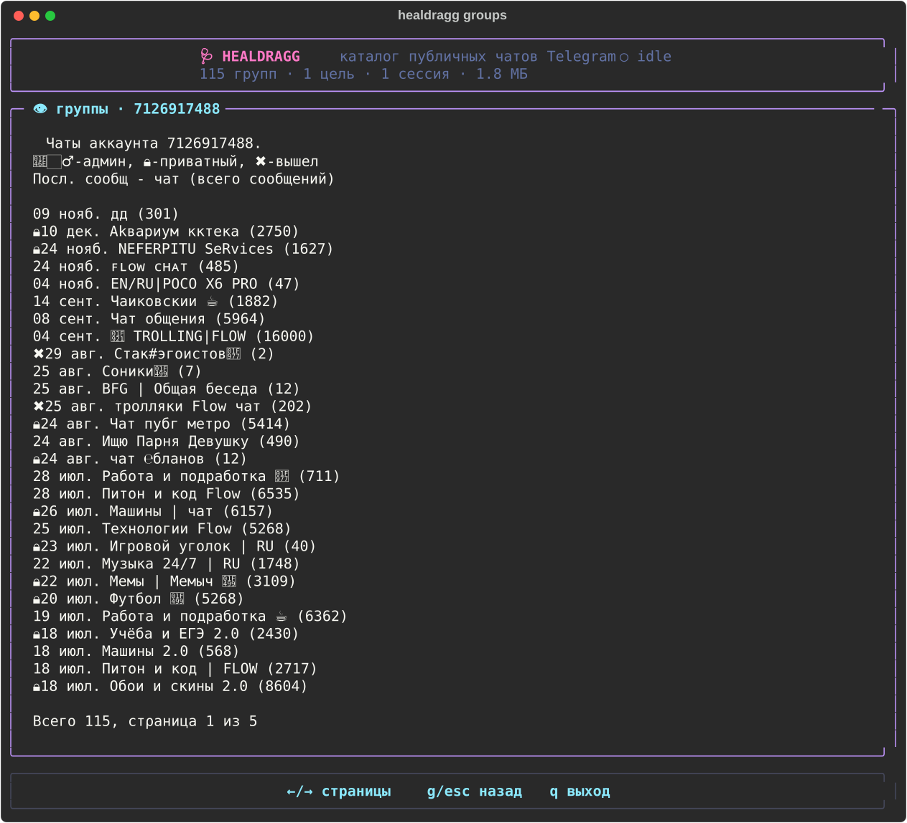
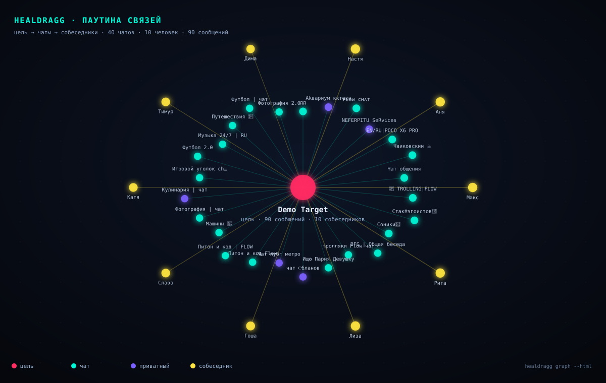

<p align="center">
  
</p>

<p align="center">
  <a href="https://github.com/syslikoffnet/s/actions/workflows/ci.yml"></a>
  <a href="https://github.com/syslikoffnet/s/actions/workflows/android.yml"></a>
  <a href="https://github.com/syslikoffnet/s/releases/latest"></a>
  
  
  
</p>

<h1 align="center">🩺 Healdragg</h1>
<p align="center"><b>Свой каталог публичных чатов Telegram — база, бот, терминал, веб и Android.</b></p>

---

## Что это

Healdragg собирает **собственную базу публичных групп и чатов** Telegram и отвечает на вопрос
«в каких открытых чатах состоит этот аккаунт» — с датой последнего сообщения, размером чата
и статусом (`админ` / `приватный` / `вышел`).

Ты присылаешь боту **id или @username**, жмёшь **👁 Группы** — и получаешь аккуратный список
с постраничной навигацией:

<p align="center">
  
</p>

```
ㅤЧаты аккаунта 7126917488.

👮🏻‍♂️-админ, 🔒-приватный, ✖️-вышел

Посл. сοобщ - чат (всего сообщений)

 09 нояб. дд (301)
 🔒10 дek. Аkвариум кктека (2750)
 🔒24 нояб. NEFERPITU SeRv.. (1627)
 24 нояб. ꜰʟᴏᴡ ᴄʜᴀᴛ (485)
 04 нояб. EN/RU|POCO X6 PR.. (47)
 14 сент. Чaиковскии ☕ (1882)
 08 сент. Чат общения (5964)
 04 сент. 🤡 TROLLING|.. (16000)
 ✖️29 авг. Стак#эгоистов🥷 (2)
 25 авг. Соники💙 (7)
 25 авг. BFG | Общая бесе.. (12)
 ✖️25 авг. тролляки Flow ч.. (202)
 🔒24 авг. Чат пубг метро (5414)
 🔒24 авг. чат ℮бланов (12)
 24 авг. Ищю Парня Девуш.. (490)

Всего 115, cтρаница 1 из 8
```

Под сообщением — кнопки `👁 Группы`, `🔄 Обновить`, `📊 Профиль`, `🏠 Меню`
и листалка `1 ⬅ · 2/8 · ➡ 3` с номерами страниц.

<p align="center">
  
</p>

<p align="center">
  
</p>

### 🕸 Паутина связей

Цель в центре, вокруг — её чаты и люди, с которыми она переписывается. Граф
интерактивный (drag, zoom, клик по узлу — карточка с силой связи и ссылкой),
а `healdragg graph <id> --html graph.html` собирает автономную страницу без CDN
и интернета — её же открывает APK.

<p align="center">
  
</p>

## Возможности

| | |
|---|---|
| 🗂 **Своя база** | Нормализованный SQLite-каталог групп: дедуп по `tg_id`, FTS-поиск, WAL, сжатие, экспорт/импорт. Метаданные чатов хранятся всегда, последние сообщения цели — только по команде и с автоочисткой. |
| 🔑 **Много сессий** | 1+ своих аккаунтов-сканеров. Каждая сессия хранит свои `access_hash`, запросы троттлятся, `FloodWait` уважается. |
| 🎯 **Цель по id / @username** | Сначала ищется «своя» сессия цели (точный список диалогов), иначе — проверка участия по каталогу + глобальный поиск сообщений. После добавления цели бот сразу запускает проверку. |
| 🔗 **Ссылки на всё** | Каждый чат хранится со ссылкой: `https://t.me/username` у публичных, `https://t.me/c/…` у приватных супергрупп и каналов. Кнопка **🔗 Ссылки** в боте, `groups --links`, поле `link` в API и экспорте. |
| 🕸 **Паутина связей** | Интерактивный граф в стиле Maltego: цель → чаты → собеседники, силы связей, drag/zoom. `healdragg graph <id> --html graph.html --open` или кнопка **🕸 Сеть** в панели. |
| 🔔 **Алерты** | Цель зашла в новый чат, вышла или написала — событие в БД, push в бот и колокольчик с непрочитанными в панели. `/alerts`, `healdragg alerts`. |
| 🛰 **Автопилот** | Сам сканирует цели, собирает активность и зажигает алерты: `AUTOPILOT_MINUTES=15` в API или `healdragg watch --activity`. |
| 🤖 **@healdragg_bot** | Кнопки, пагинация, прогресс скана с отменой, allowlist владельца, антифлуд. |
| 🖥 **TUI** | Живая панель: сессии, размер базы, цель, журнал, полноэкранный список, управление клавишами. |
| 🌐 **Веб-панель + REST** | Тёмный адаптивный интерфейс: hero-поиск, живые плитки, сетка быстрых действий, нижняя навигация на телефоне, шиты «ссылки / лента / алерты». |
| 📜 **Что пишет** | Лента последних сообщений цели с датами, чатами и ссылками — `/feed`, `healdragg activity`, вкладка **📜 Лента**. |
| 📴 **Офлайн-режим** | Панель и APK кэшируют последние ответы API в localStorage: без движка открывается снимок данных с плашкой «офлайн · кэш». |
| 📱 **Android APK** | Python-движок (Chaquopy) прямо в APK: Termux, pip и Rust на телефоне не нужны. Запуск в один тап, foreground-сервис, автозапуск после перезагрузки, нативные уведомления об алертах, лог в приложении, офлайн-кэш, R8 в release. |
| 📟 **Termux** | Для консольного режима и бота: `install.sh` + `termux/termuxctl.sh` (фон, wake-lock, автозапуск, логи). APK он больше не нужен. |
| 🧪 **Тесты** | 89 тестов: формат сообщений, БД, пагинация, API, клавиатуры. |

## Установка

> Ставишь APK — клонировать и ставить ничего не нужно: движок, панель и команды
> уже внутри приложения, см. [Android APK](#android-apk).

### Termux (Android)

```bash
pkg install git
git clone https://github.com/syslikoffnet/s.git
cd s
bash install.sh
nano .env            # API_ID, API_HASH, BOT_TOKEN
```

Установщик сам поставит `python`, создаст `.venv`, поставит зависимости
(панель — на `starlette`, без `pydantic-core` и Rust), сделает команду
`healdragg` и папку `data/`. Бот (`aiogram`) — отдельный шаг: на Termux он
по умолчанию пропускается, включить — `bash install.sh --with-bot`.

Дальше:

```bash
healdragg demo            # посмотреть, как всё выглядит, без Telegram
healdragg session add main
healdragg bootstrap       # собрать базу публичных чатов
healdragg bot             # бот
```

Фоновый режим и автозапуск:

```bash
bash termux/termuxctl.sh start all     # бот + панель
bash termux/termuxctl.sh status
bash termux/termuxctl.sh logs bot
bash termux/termuxctl.sh autostart     # после перезагрузки (нужен termux-boot)
```

### Linux / macOS

```bash
git clone https://github.com/syslikoffnet/s.git && cd s
python3 -m venv .venv && . .venv/bin/activate
pip install -e ".[dev]"
cp .env.example .env && nano .env
healdragg init
```

### Где взять ключи

1. **API_ID / API_HASH** — <https://my.telegram.org> → *API development tools*.
2. **BOT_TOKEN** — у [@BotFather](https://t.me/BotFather) (`/newbot`), имя `@healdragg_bot`.
3. **Свой id** — команда `/id` в боте; впиши в `BOT_ALLOWED_USERS`.

> Бот по умолчанию **закрыт**: если allowlist пуст, владельцем становится тот, кто первым
> отправит `/start`. Остальные получат отказ. Это защищает чужие запросы к твоей базе.

## Быстрый старт

```bash
healdragg init                  # .env + база + токен панели
healdragg demo                  # демо-данные (115 чатов) — посмотреть формат
healdragg session add main      # вход в свой аккаунт (код из Telegram)
healdragg bootstrap             # диалоги + поиск публичных чатов по словам
healdragg target add 7126917488
healdragg scan 7126917488       # проверить участие цели по каталогу
healdragg cover 7126917488      # с нуля: база + вступления + проверка + список
healdragg groups 7126917488 -i  # листать стрелками
healdragg bot                   # @healdragg_bot
healdragg tui                   # живая панель
healdragg api                   # веб-панель для Android
```

## Как наполняется база

```
bootstrap
 ├─ диалоги всех сессий       → публичные и приватные чаты, где состоишь ты
 ├─ contacts.search по словам → новые публичные чаты (без вступления)
 └─ --join (опционально)      → вступление в найденные чаты (лимит/сутки, пауза)
```

Когда база пуста — это нормально. Порядок: `session add` → `bootstrap` → `target add` → `scan`.
В боте для этого есть кнопка **🚀 Собрать базу** и онбординг-подсказки.

Если хочется одной командой «найти всё про человека с нуля»:

```bash
healdragg cover 7126917488 --join-limit 15
```

Она собирает базу, вступает в найденные публичные чаты в пределах дневного лимита,
проверяет цель и сразу печатает список. В боте то же поведение включается
`JOIN_ON_BOOTSTRAP=true`.

### Как ищется цель

1. **Своя сессия цели** — если добавил сессию самого аккаунта, список берётся из её диалогов:
   это самый точный и быстрый путь (даты и счётчики сообщений).
2. **Проверка по каталогу** — `channels.getParticipant` по чатам, где состоят твои сессии.
   Статус `админ/создатель/участник`, а `✖️ вышел` — если цель была найдена раньше и пропала.
3. **Глобальный поиск** — `messages.search` с `from_id` (best-effort: сервер может запретить).
   Найденные чаты добираются в каталог.

Числовой id без `access_hash` иногда не резолвится сразу — хеш подтянется, как только цель
встретится в общих публичных чатах. Если есть `@username` — резолв мгновенный.

## Бот

| Кнопка / команда | Что делает |
|---|---|
| `👁 Группы` | Список чатов цели, 15 на страницу, кнопки `1 ⬅ · 1/8 · ➡ 2` |
| `🕸 Сеть` | Паутина связей и топ собеседников прямо в сообщении |
| `📜 Лента` | Что цель писала последним — без выхода из бота |
| `📡 Собрать активность` | Запуск сбора сообщений и связей из карточки |
| `🎯 Цели` | Все добавленные цели, переключение одним нажатием |
| `🔄 Обновить` | Запускает скан цели с прогрессом и кнопкой отмены |
| `📊 Профиль` | Счётчики: всего, админ, приватные, вышел |
| `🚀 Собрать базу` | `bootstrap` прямо из чата |
| `/start`, `/help` | Меню и справка |
| `/target <id\|@user>` | Карточка цели |
| `/targets` | Список целей |
| `/scan [id]` | Перепроверить цель (по умолчанию последнюю) |
| `/links [id]` | Ссылки на все чаты цели (t.me/…) |
| `/network [id]` | Топ собеседников и сила связей |
| `/feed [id]` | Последние сообщения цели |
| `/activity [id]` | Собрать сообщения и связи (фоном) |
| `/alerts` | Что нового: новые чаты, выходы, сообщения |
| `/find <слово>` | Поиск по каталогу (FTS5) |
| `/stats` | Размер базы, покрытие, цели |
| `/id` | Твой Telegram id |
| `/stop` | Остановить сканы |

## CLI

```
healdragg init                     .env, каталоги, база
healdragg demo [--clear]           демо-данные
healdragg session add|list|remove|import
healdragg bootstrap [--join] [--queries ...] [--no-meta]
healdragg target add|list|remove
healdragg scan <query> [--deep] [--max-groups N]
healdragg cover <query> [--no-join] [--join-limit N] [--queries ...]
healdragg activity <query> [--days N] [--per-chat N] [--max-chats N]
healdragg graph <query> [--html PATH] [--json] [--peers N] [--open]
healdragg alerts [--limit N] [--read]
healdragg watch [--minutes N] [--once] [--activity] [--alerts]
healdragg groups <query> [-i] [--page N] [--size N] [--plain] [--json] [--html] [--links]
healdragg catalog [--query Q] [--page N]
healdragg stats | doctor
healdragg db optimize|vacuum|check|stats|export|import
healdragg bot | api | tui
```

### TUI

`←/→` — страницы, `↑/↓` — цель, `g` — полноэкранный список, `b` — собрать базу,
`r` — проверить цель, `d` — демо, `q` — выход.

## Веб-панель и API

```bash
healdragg api --host 0.0.0.0 --port 8080 --show-token
```

Открой `http://<ip>:8080`, введи `API_TOKEN`. Токен можно передать сразу:
`http://<ip>:8080/?token=...`.

Что внутри: hero-поиск цели, плитки базы, карточка цели с плитками «сообщений /
собеседников / алертов», сетка действий (**Группы · Сеть · Лента · Ссылки ·
Активность · Обновить · Текст · База**), колокольчик с непрочитанными и шиты
со ссылками на каждый чат. На телефоне снизу появляется навигация
**Цель · Сеть · Алерты · База**, `Esc` закрывает любой шит.

| Метод | Путь | Назначение |
|---|---|---|
| `GET` | `/api/health` | живость (без токена) |
| `GET` | `/api/stats` | база, покрытие, размер |
| `GET` | `/api/sessions` | сессии |
| `GET`/`POST` | `/api/targets` | список / добавить цель |
| `GET` | `/api/targets/{id}/groups?page=&size=` | чаты + готовый текст |
| `POST` | `/api/targets/{id}/scan` | скан в фоне |
| `GET` | `/api/targets/{id}/links?limit=` | ссылки на чаты цели |
| `GET` | `/api/targets/{id}/graph` | паутина связей |
| `GET` | `/api/targets/{id}/activity` | лента и связи |
| `POST` | `/api/targets/{id}/activity/collect` | сбор активности в фоне |
| `GET` | `/api/alerts` | алерты и непрочитанные |
| `POST` | `/api/alerts/read` | пометить прочитанными |
| `POST` | `/api/bootstrap` | сбор базы |
| `GET` | `/api/jobs` | прогресс задач |
| `GET` | `/api/catalog?q=&page=` | каталог |
| `GET` | `/api/find?q=` | поиск |
| `GET` | `/api/export/{id}` | JSON-экспорт |

Заголовок `X-Api-Token` или `?token=`. Список методов — `/api/docs`
(лёгкая HTML-страница, без OpenAPI-схемы).

## Android APK

APK собирается автоматически в **GitHub Actions** → workflow **Android APK** и лежит в
[**Releases**](https://github.com/syslikoffnet/s/releases/latest):

1. Скачай `healdragg-release.apk` и поставь на телефон.
2. Введи `API_ID` и `API_HASH` (my.telegram.org → API development tools) — один раз.
3. Нажми **⚡ Запустить движок**. Python-движок стартует внутри приложения
   (foreground-сервис) и поднимает панель на `127.0.0.1:8080`; нативные экраны
   приложения читают её REST API. **Termux, pip, Rust, `git clone` и ПК не нужны.**
4. Войди в Telegram в разделе **«Аккаунты»**: номер → код из Telegram → пароль 2FA,
   если он включён. Вход целиком в приложении, `.session` получает движок.
5. Разреши «Без ограничений батареи», чтобы Android не усыплял движок.
   После перезагрузки и после обновления APK движок поднимается сам.

Что внутри:

- **Нативные экраны на Compose.** Цели, алерты, база чатов с поиском и листанием,
  карточка цели с чатами, лентой и паутиной связей (`Canvas` с зумом и тапом по
  узлам), подарки с NFT-метками, настройки, аккаунты — без WebView. На телефоне —
  нижние табы, на планшете — боковой rail и две колонки; экраны переживают
  поворот и смену шрифта.
- **Material 3 одним тумблером.** «Настройки → Оформление» переключает между
  Material 3 (мягкие поверхности, крупные скругления, акцентные чипы) и прежней
  компактной моно-темой. Применяется сразу ко всем экранам, без перезапуска.
- **Векторные иконки вместо эмодзи** в навигации, алертах, карточках и пустых
  состояниях: мишень, колокольчик, подарок, щит-логотип нарисованы стандартным
  набором Material Icons и корректно красятся в обеих темах.
- **Сбор базы из приложения**: прогресс, отмена и результат прямо в настройках и
  на вкладке «База»; любой чат из базы можно открыть или сразу сделать целью.
- **Вход в Telegram в приложении** (`/api/session/*`): номер, код, пароль 2FA,
  список и удаление аккаунтов-сканеров. CLI-команда `session add` осталась для ПК.
- **Chaquopy 17.2 + CPython 3.13** — интерпретатор и весь стек (`telethon`,
  `starlette`, `uvicorn`, `rich`, `python-dotenv`) лежат в APK и ставятся на
  этапе сборки, а не на телефоне. Ни одного нативного пакета: `pydantic-core`
  с его Rust-сборкой больше не участвует.
- **Foreground-сервис** (`dataSync`) с уведомлением «движок работает», кнопкой
  «Остановить» и перезапуском после перезагрузки (`BOOT_COMPLETED`).
- **Лог в приложении**: кнопка «Лог движка» показывает последние строки
  `files/engine/logs/engine.log` — отладка без Termux и без `adb`.
- **ABI**: `arm64-v8a` и `x86_64` (Python 3.13 поддерживает только 64 бита).
  Release-APK ≈ 44 МБ, debug ≈ 50 МБ: внутри лежит полноценный CPython
  со стандартной библиотекой и пакетами. Первый запуск движка занимает
  несколько секунд — Python распаковывается один раз.
- **Уведомления об алертах**: раз в 15 минут приложение спрашивает
  `api/alerts?unread=true` и показывает нативные уведомления Android, даже
  когда приложение закрыто.

Путь «свой сервер» остался: если панель живёт на компьютере или VPS, впиши
адрес и `API_TOKEN` — приложение подключится к ней вместо локального движка.
Без сети APK открывает последний снимок из кэша с плашкой «офлайн · кэш».

Локальная сборка (нужны Android SDK, JDK 17 и Python 3.13 на машине сборки):

```bash
cd android && gradle assembleDebug
```

**Подпись не меняется.** Debug и release подписываются одним ключом
`android/keystore/healdragg.p12` (только для сайдлоада), поэтому обновления
ставятся поверх старой версии — удалять приложение и терять настройки не нужно.
Для Google Play понадобится отдельный ключ.

**Почему исходники не лежат в APK открытым текстом.** Chaquopy по умолчанию
компилирует Python-код в байткод и **не кладёт `.py` в APK** — `unzip` показывает
только `.pyc`. Release-сборка дополнительно идёт через R8
(`isMinifyEnabled`, `isShrinkResources`), `debuggable=false`, автобэкап выключен.
Это барьер для «распаковал и забрал», а не абсолютная защита: владелец
устройства всегда может добраться до установленных файлов.

## Хранение: как оптимизировано

```
sessions ──┐
           ├── session_groups ── groups ── target_groups ── targets
scans      │                     │
events     └─────────────────────┴── groups_fts (FTS5)
```

* **Одна запись на чат** (`groups.tg_id UNIQUE`) — названия и счётчики не дублируются между целями.
* **Связь «цель × чат»** — компактная строка `(target_id, group_id, status, source, даты)`.
* **Целые timestamp'ы**, никаких строковых дат и JSON-полей в горячих таблицах.
* **WAL + NORMAL + mmap + auto_vacuum + checkpoint**, `db optimize` / `db vacuum`.
* **FTS5** по названию и username (триггеры держат индекс в актуальном состоянии).
* **Ссылка на каждый чат** (`groups.link`): `t.me/username`, для приватных супергрупп и каналов — `t.me/c/<internal>/1`. Заполняется при импорте старых баз и при каждом апсерте.
* **Метаданные чатов** — всегда. **Сообщения цели** — только после `activity`: таблица `messages` с окном `ACTIVITY_DAYS`, автоочистка `prune_activity` (3× окно).
* **Связи** — агрегаты `edges (target_id, peer_id, weight, replies, mentions, last_seen)` без дублей сообщений; собеседники — в `peers`.
* **Дневные счётчики** вступлений — в `meta`, чтобы лимит не сбрасывался при перезапуске.
* **«Вышел»** — если чат был в диалогах цели, а теперь пропал, связь помечается `left`, а не удаляется.
* **Basic-группы** проверяются через `messages.getFullChat`, а не `channels.getParticipant`.
* **Каналы цели** тоже попадают в базу: глобальный поиск по её сообщениям находит broadcast-каналы, помечает их `admin` (писать в канал может только админ) и тянет метаданные.
* Ориентир: **10 000 групп + связи ≈ 5,5 МБ**, заполнение ~2,5 секунды (проверено в CI-окружении).
* `groups.meta_checked_at` + `META_TTL_HOURS` — не дёргаем Telegram лишний раз.

## Конфигурация

Всё в `.env` (шаблон — `.env.example`):

| Переменная | По умолчанию | Смысл |
|---|---|---|
| `API_ID`, `API_HASH` | — | ключи my.telegram.org |
| `BOT_TOKEN` | — | токен @BotFather |
| `BOT_ALLOWED_USERS` | — | id через запятую |
| `BOT_ALLOW_ALL` | `false` | открыть бота всем (не рекомендуется) |
| `API_TOKEN` | генерируется | доступ к панели/API |
| `API_HOST`, `API_PORT` | `0.0.0.0`, `8080` | панель |
| `SCAN_MIN_DELAY`, `SCAN_JITTER` | `1.4`, `0.6` | пауза между запросами |
| `SCAN_MAX_GROUPS` | `2000` | лимит проверок за прогон |
| `JOIN_LIMIT` | `20` | вступлений за сутки **на сессию** (0 — не вступать) |
| `AUTO_SCAN_ON_ADD` | `true` | сразу проверять цель после добавления в боте |
| `JOIN_ON_BOOTSTRAP` | `false` | вступать в найденные чаты при сборе базы из бота/панели |
| `ACTIVITY_DAYS` | `30` | окно сообщений цели для ленты и графа |
| `ACTIVITY_PER_CHAT` | `40` | сколько последних сообщений цели читать из чата |
| `ACTIVITY_MAX_CHATS` | `80` | сколько чатов обходить при сборе активности |
| `ALERT_PUSH` | `true` | присылать алерты в Telegram |
| `ALERT_INTERVAL` | `20` | как часто бот проверяет очередь алертов, сек |
| `AUTOPILOT_MINUTES` | `0` | авто-обход целей в API (`0` — выключен) |
| `AUTO_ACTIVITY_ON_SCAN` | `false` | собирать активность после каждого скана |
| `META_TTL_HOURS` | `12` | как часто обновлять счётчики чата |
| `PAGE_SIZE`, `TITLE_LIMIT` | `15`, `15` | вид списка |
| `TZ` | `Europe/Moscow` | часовой пояс дат |
| `SEARCH_QUERIES` | встроенные | слова для поиска чатов |

## Ограничения и честные предупреждения

* Видны **только открытые чаты** и только те, где состоят твои сессии. Приватные чаты цели
  можно увидеть лишь при наличии её собственной сессии.
* Telegram может ответить `FloodWait` или ограничить аккаунт за агрессивный скрейпинг.
  Скрипт спит ровно столько, сколько просят, но **риск бана сессии остаётся** — не гоняй
  тысячи проверок в минуту и не используй основной аккаунт.
* Даты и счётчики кешируются (`META_TTL_HOURS`), поэтому не «живые» до следующего обновления.
* Числовой id без `access_hash` может не резолвиться — добавь `@username` или общие чаты.
* Сессии — это твои аккаунты. Не передавай `.session` файлы никому: это полный доступ к аккаунту.

## Этика и право

Инструмент работает с **публичными** данными: названия открытых чатов, факт участия,
дата последнего сообщения и счётчик сообщений. Он **не читает переписку**, не сохраняет
контент и не обходит приватность закрытых чатов.

* Используй только свои аккаунты-сессии.
* Соблюдай [Terms of Service Telegram](https://telegram.org/tos) и законы своей страны.
* Не используй для травли, слежки за людьми без согласия и любых противоправных действий.
* Ответственность за использование — на операторе.

## Структура

```
healdragg/
  config.py     настройки (.env)
  db.py         SQLite: схема, запросы, экспорт/импорт
  tg.py         пул сессий, троттлинг, resolve, getParticipant
  scan.py       bootstrap / probe / global search, прогресс
  textfmt.py    «телеграмный» формат, профили, статистика
  bot/          aiogram: handlers, keyboards, middlewares, deps
  tui.py        живая панель (rich)
  cli.py        команды
  api.py        REST + веб-панель
  web/          интерфейс панели
android/        Kotlin/WebView клиент + Gradle
termux/         управление фоновыми процессами
scripts/        запуск и генерация превью
legacy/         исходный syntax.py (сохранён для истории)
docs/           SVG-превью и баннер
```

## Тесты

```bash
pip install -r requirements-dev.txt
pytest -q
ruff check healdragg tests
```

89 тестов покрывают точный формат сообщения, пагинацию, БД (дедуп, каскады, FTS, экспорт),
API с токеном, клавиатуры и лимиты Telegram-сообщений.

## Roadmap

* несколько целей одновременно и очередь сканов;
* сравнение «было/стало» (новые/потерянные чаты);
* SQLite → PostgreSQL для нескольких воркеров;
* нативные уведомления в Android-приложении (алерты уже есть в панели);
* экспорт в CSV/GraphML для графа пересечений.

---

<p align="center"><sub>Сделано с 🩺 и уважением к публичности. Healdragg не связан с Telegram.</sub></p>
